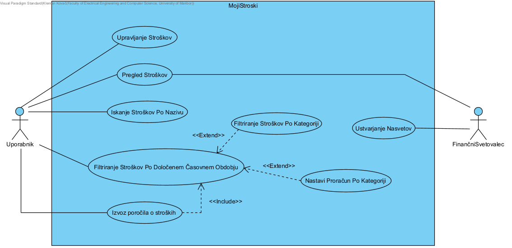

# Moji stroški

Spletna aplikacija za beleženje, pregledovanje, urejanje in analiziranje osebnih stroškov. Uporabnik lahko dodaja nove stroške, jih ureja ali briše ter analizira porabo v izbranem časovnem obdobju in po kategorijah.


## Kazalo

1.  [Sodelujoči](#sodelujoči)
2.  [O projektu](#o-projektu)
3.  [Vizija projekta](#vizija-projekta)
    -   [Opis rešitve](#opis-rešitve)
    -   [Ključne funkcionalnosti](#ključne-funkcionalnosti)
    -   [Obseg rešitve in morebitne
        omejitve](#obseg-rešitve-in-morebitne-omejitve)
4.  [Uporabljene tehnologije](#uporabljene-tehnologije)
5.  [Struktura projekta](#struktura-projekta)
6.  [Zahteve za namestitev](#zahteve-za-namestitev)
7.  [Namestitev in zagon](#namestitev-in-zagon)
8.  [Funkcionalnosti aplikacije](#funkcionalnosti-aplikacije)
9.  [API-endpointi](#api-endpointi)
10. [Navodila za razvijalce](#navodila-za-razvijalce)
11. [Standardi kodiranja](#standardi-kodiranja)
12. [Besednjak](#besednjak)


## Sodelujoči

Imena članov skupine:
- Luka Poprask
- Tim Kovačič
- Klemnen Kovač

## O projektu

**Moji stroški** je spletna aplikacija, namenjena spremljanju osebnih financ. Omogoča enostavno beleženje vsakodnevnih izdatkov in pregled nad porabo.

Vsak strošek vsebuje:
- opis stroška,
- znesek,
- kategorijo,
- datum.

Aplikacija je sestavljena iz treh glavnih delov:
- **Frontend:** uporabniški vmesnik, izdelan z ogrodjem React.
- **Backend:** strežniški del (REST API), izdelan s Spring Boot.
- **Podatkovna baza:** PostgreSQL, ki shranjuje podatke o stroških in teče v Docker vsebniku.


## Vizija projekta

Vizija projekta **Moji stroški** je razviti preprosto in pregledno spletno aplikacijo, ki uporabnikom omogoča učinkovito spremljanje osebnih stroškov. Namen aplikacije je uporabnikom olajšati beleženje stroškov, omogočiti boljši pregled nad porabo denarja ter jim pomagati pri razumevanju njihovih potrošniških navad.

Aplikacija je namenjena posameznikom, ki želijo na enem mestu spremljati svoje vsakodnevne stroške, da bi tako dobili boljši nadzor nad porabo lastnih financ. Le te lahko razvrščajo po kategorijah in analizirajo porabo v izbranem časovnem obdobju.

### Opis rešitve

Rešitev predstavlja spletna aplikacija, sestavljena iz uporabniškega vmesnika, strežniškega dela in podatkovne baze. Uporabnik prek uporabniškega vmesnika upravlja svoje stroške, backend obdeluje zahtevke in skrbi za komunikacijo s podatkovno bazo, v kateri se podatki trajno shranjujejo.

Vsak zabeležen strošek vsebuje opis, znesek, kategorijo in datum. Na podlagi shranjenih podatkov lahko uporabnik spremlja skupno porabo ter izvede analizo stroškov za izbrano časovno obdobje in kategorijo.

#### Ključne funkcionalnosti

Aplikacija vključuje naslednje ključne funkcionalnosti:

- **Dodajanje stroškov:** uporabnik lahko vnese nov strošek z opisom, zneskom, kategorijo in datumom.
- **Pregled stroškov:** prikaz vseh zabeleženih stroškov na enem mestu.
- **Urejanje stroškov:** uporabnik lahko spremeni podatke že obstoječega stroška.
- **Brisanje stroškov:** uporabnik lahko odstrani stroške, ki jih ne želi več hraniti.
- **Pregled porabe:** prikaz skupnega zneska vseh stroškov in števila zabeleženih stroškov.
- **Analiza stroškov:** izračun skupne porabe v izbranem časovnem obdobju.
- **Filtriranje po kategorijah:** možnost omejitve analize na izbrano kategorijo stroškov.

#### Obseg rešitve in morebitne omejitve

Projekt zajema razvoj osnovne spletne aplikacije za osebno spremljanje stroškov. Vključuje uporabniški vmesnik, REST API za upravljanje podatkov ter PostgreSQL podatkovno bazo za njihovo shranjevanje.

Aplikacija trenutno omogoča:
- upravljanje posameznih stroškov,
- razvrščanje stroškov v vnaprej določene kategorije,
- pregled skupne porabe,
- analizo porabe glede na časovno obdobje in kategorijo.

Cilj prihodnjih nadgradenj bi bil razširiti funkcionalnosti aplikacije in uporabnikom ponuditi še boljši pregled nad njihovimi osebnimi financami.

## Uporabljene tehnologije

Navedene so verzije iz konfiguracijskih datotek `pom.xml` in `package.json`. Pri frontendu predpona `^` pomeni »ta ali novejša različica znotraj iste glavne različice«. Dejansko nameščene različice so zapisane v `package-lock.json`.

### Backend

| Tehnologija | Verzija | Namen |
|---|---|---|
| Java | 25 | programski jezik |
| Spring Boot | 4.1.1 | ogrodje za backend |
| Spring Web MVC | iz Spring Boot 4.1.1 | REST API |
| Spring Data JPA | iz Spring Boot 4.1.1 | dostop do podatkov |
| PostgreSQL JDBC Driver | iz Spring Boot 4.1.1 | povezava s PostgreSQL |
| Springdoc OpenAPI | 3.1.1 | Swagger UI dokumentacija API-ja |
| H2 Database | iz Spring Boot 4.1.1 | **vključena v `pom.xml`, vendar se v aplikaciji ne uporablja** (aplikacija uporablja PostgreSQL) |
| Maven Wrapper | priložen v projektu | gradnja in zagon brez ločene namestitve Mavena |

### Frontend

| Tehnologija | Verzija | Namen |
|---|---|---|
| React | ^19.3.1 | uporabniški vmesnik |
| React DOM | ^19.3.1 | izris komponent |
| Vite | ^8.3.4 | razvojni strežnik in gradnja |
| Axios | ^1.20.0 | HTTP zahteve do backenda |
| ESLint | ^10.13.0 | preverjanje kakovosti kode |
| @vitejs/plugin-react | ^6.1.2 | podpora za React v Vite |
| JavaScript, HTML, CSS | – | jeziki frontenda |

### Podatkovna baza in razvojna orodja

| Orodje | Verzija / opomba |
|---|---|
| PostgreSQL | 18 (Docker slika `postgres:18`) |
| Docker Desktop in Docker Compose | zagon podatkovne baze |
| DataGrip | pregled podatkovne baze (neobvezno) |
| IntelliJ IDEA | priporočeno razvojno okolje |
| Postman | testiranje API-ja |
| Git in GitHub | upravljanje izvorne kode |

## Struktura projekta

Po kloniranju repozitorija dobimo mapo `moji-stroski/`, ki je razdeljena na štiri glavne mape:

```text
moji-stroski/
├── backend/
│   ├── .mvn/
│   ├── src/
│   │   ├── main/
│   │   │   ├── java/si/student/backend/
│   │   │   │   ├── controller/
│   │   │   │   │   └── StrosekController.java
│   │   │   │   ├── repository/
│   │   │   │   │   └── StrosekRepository.java
│   │   │   │   ├── services/
│   │   │   │   │   └── Strosek.java
│   │   │   │   └── BackendApplication.java
│   │   │   └── resources/
│   │   │       ├── static/
│   │   │       ├── templates/
│   │   │       └── application.properties
│   │   └── test/
│   │       └── java/si/student/backend/
│   │           └── BackendApplicationTests.java
│   ├── mvnw
│   ├── mvnw.cmd
│   └── pom.xml
├── DPU/
│   └──DPU.png
├── frontend/
│   ├── public/
│   ├── src/
│   │   ├── assets/
│   │   ├── services/
│   │   │   └── api.js
│   │   ├── App.jsx
│   │   ├── App.css
│   │   ├── index.css
│   │   └── main.jsx
│   ├── index.html
│   ├── eslint.config.js
│   ├── package.json
│   ├── package-lock.json
│   └── vite.config.js
├── database/
│   ├── docker-compose.yml
│   └── .env.example
├── postman/
│   ├── collections/
│   ├── documents/
│   ├── environments/
│   ├── flows/
│   ├── globals/
│   ├── mocks/
│   └── specs/
├── .gitignore
└── README.md
```

| Mapa | Vsebina |
|---|---|
| `backend` | strežniška aplikacija (Spring Boot, REST API) |
| `frontend` | uporabniški vmesnik (React + Vite) |
| `database` | konfiguracija podatkovne baze (Docker Compose) |
| `postman` | zbirke in konfiguracije za testiranje API-ja |

## Zahteve za namestitev

Pred zagonom projekta morajo biti nameščeni:

- **Java JDK 25** – za izvajanje backend aplikacije.
- **Node.js in npm** – za izvajanje frontend aplikacije.
- **Docker Desktop** – za zagon PostgreSQL podatkovne baze.
- **Git** – za upravljanje izvorne kode.
- **IntelliJ IDEA** – priporočeno razvojno okolje (neobvezno).
- **DataGrip** – priporočeno orodje za pregledovanje podatkovne baze (neobvezno).

Maven ni treba nameščati posebej, ker projekt vsebuje Maven Wrapper (`mvnw`, `mvnw.cmd`).

Različice, uporabljene pri razvoju:
- Java: 25
- Node.js: 24.11.1
- npm: 11.6.2
- PostgreSQL: 18
- Spring Boot: 4.1.1

## Namestitev in zagon

Za delovanje aplikacije je treba zagnati **tri dele v tem vrstnem redu**: podatkovno bazo, backend in frontend. Vsak del teče v svojem terminalu.

### 1. Prenos projekta

```bash
git clone https://github.com/TimKovacic/moji-stroski.git
cd moji-stroski
```

Nato odpremo mapo projekta v IntelliJ IDEA ali drugem urejevalniku kode.

### 2. Zagon podatkovne baze

Podatkovna baza PostgreSQL se zažene s pomočjo Docker Compose. Preden nadaljujemo, mora biti Docker Desktop zagnan.

Premaknemo se v mapo `database`:

```bash
cd database
```

Iz vzorčne datoteke ustvarimo svojo datoteko `.env`.

**Windows (PowerShell):**

```powershell
Copy-Item .env.example .env
```

**macOS / Linux:**

```bash
cp .env.example .env
```

Odpremo datoteko `database/.env` in nastavimo svoje geslo:

```env
DB_PASSWORD=izbrano_varno_geslo
```

Datoteka `.env` je v `.gitignore`, zato se ne objavi na GitHubu. Gesla ne objavljamo v repozitoriju.

Zaženemo podatkovno bazo:

```bash
docker compose up -d
```

Preverimo, ali podatkovna baza deluje (stanje mora biti `running`):

```bash
docker compose ps
```

Podatkovna baza uporablja naslednje nastavitve:

| Nastavitev | Vrednost |
|---|---|
| Vrsta podatkovne baze | PostgreSQL |
| Različica | 18 |
| Ime vsebnika | `moji-stroski-db` |
| Ime podatkovne baze | `stroski` |
| Uporabniško ime | `postgres` |
| Geslo | vrednost `DB_PASSWORD` iz datoteke `.env` |
| Vrata na računalniku | 5433 |
| Vrata v Docker vsebniku | 5432 |

Podatki se shranjujejo v Docker volume `postgres_data`, zato ostanejo ohranjeni tudi po ustavitvi vsebnika.

**Tabela `strosek` se ustvari samodejno.** Ob prvem zagonu backenda jo ustvari Hibernate (nastavitev `spring.jpa.hibernate.ddl-auto=update`), zato SQL skripte ni treba izvajati ročno.

Za ustavitev podatkovne baze uporabimo:

```bash
docker compose down
```

**Pomembno:** Ukaza `docker compose down -v` ne uporabljamo, če želimo ohraniti podatke, ker odstrani tudi Docker volume.
Lahko pa aplikacijo preprosto zapremo, a se v ozadju še vedno izvaja Docker daemon, zato ga lahko ustavimo preko opravilne vrstice, kjer z desnim klikom kliknemo na ikono Dockerja ter nato `Quit Docker Desktop`. Ali pa prekinemo opravilo Upravljitelju opravil.

### 3. Zagon backend aplikacije

Backend se nahaja v mapi `backend`. Konfiguracija je v datoteki:

```text
backend/src/main/resources/application.properties
```

Povezava s podatkovno bazo je nastavljena tako:

```properties
spring.datasource.url=jdbc:postgresql://localhost:5433/stroski
spring.datasource.username=postgres
spring.datasource.password=${DB_PASSWORD}
spring.jpa.hibernate.ddl-auto=update
spring.jpa.show-sql=true
```

Backend potrebuje okoljsko spremenljivko `DB_PASSWORD`. Njena vrednost mora biti **enaka geslu**, ki je nastavljeno v datoteki `database/.env`.

**Možnost A: zagon v IntelliJ IDEA**

1. Odpremo **Run → Edit Configurations**.
2. Pri konfiguraciji aplikacije `BackendApplication` v polje **Environment variables** vpišemo:

```text
DB_PASSWORD=izbrano_varno_geslo
```

3. Zaženemo aplikacijo `BackendApplication`.

**Možnost B: zagon v terminalu**

Najprej se premaknemo v mapo `backend`.

*Windows (PowerShell):*

```powershell
cd backend
$env:DB_PASSWORD="izbrano_varno_geslo"
.\mvnw.cmd spring-boot:run
```

*macOS / Linux:*

```bash
cd backend
export DB_PASSWORD="izbrano_varno_geslo"
./mvnw spring-boot:run
```

Namesto `izbrano_varno_geslo` uporabimo dejansko geslo iz datoteke `.env`.

Če je zagon uspešen, backend posluša na naslovu:

```text
http://localhost:8080
```

Dokumentacija API-ja (Swagger UI) je dostopna na:

```text
http://localhost:8080/swagger-ui/index.html
```

### 4. Zagon frontend aplikacije

Frontend se nahaja v mapi `frontend`. Odpremo nov terminal in se premaknemo vanjo:

```bash
cd frontend
```

Namestimo potrebne odvisnosti (samo ob prvem zagonu ali po spremembi `package.json`):

```bash
npm install
```

Zaženemo razvojni strežnik:

```bash
npm run dev
```

Po uspešnem zagonu je aplikacija dostopna na naslovu:

```text
http://localhost:5173
```

Frontend za komunikacijo z backendom uporablja Axios. Povezava je nastavljena v datoteki `frontend/src/services/api.js`:

```javascript
import axios from 'axios'

const api = axios.create({
    baseURL: 'http://localhost:8080/api/stroski',
})

export default api
```

**Opomba o CORS:** Backend sprejema zahteve samo z naslova `http://localhost:5173` (nastavljeno v `StrosekController` z `@CrossOrigin`). Če frontend teče na drugih vratih, jih je treba tam ustrezno popraviti.

**Pomembno:** Podatkovna baza, backend in frontend morajo biti hkrati zagnani, da aplikacija deluje v celoti.

### Pogoste težave

| Težava | Rešitev |
|---|---|
| Backend se ne poveže z bazo | Preverimo, ali Docker vsebnik teče (`docker compose ps`) in ali je `DB_PASSWORD` enak v `.env` in v okoljski spremenljivki backenda. |
| Vrata 5433, 8080 ali 5173 so zasedena | Ustavimo program, ki jih uporablja, ali zamenjamo vrata v konfiguraciji. |
| Frontend ne prikaže podatkov | Preverimo, ali backend teče na `http://localhost:8080` in ali frontend teče na vratih 5173. |
| Po spremembi gesla v `.env` povezava ne deluje | Geslo se v bazi nastavi ob prvem zagonu. Če ga spremenimo pozneje, je treba volume izbrisati z `docker compose down -v` (izgubimo vse podatke). |

## Funkcionalnosti aplikacije

Aplikacija omogoča:

- dodajanje novih stroškov,
- pregled vseh shranjenih stroškov,
- urejanje obstoječih stroškov,
- brisanje stroškov,
- prikaz skupnega zneska vseh stroškov,
- prikaz števila zabeleženih stroškov,
- analizo stroškov v izbranem časovnem obdobju,
- filtriranje analize po kategoriji,
- prikaz skupne porabe za izbrano obdobje.

Pri vnosu stroška uporabnik določi opis, znesek, kategorijo in datum.

Na voljo so naslednje kategorije:
- Hrana
- Prevoz
- Stanovanje
- Prosti čas
- Zdravje
- Drugo

Zneski so prikazani v evrih (EUR).

## API-endpointi

Backend omogoča REST API za upravljanje stroškov.

Osnovni naslov API-ja:

```text
http://localhost:8080/api/stroski
```

| HTTP metoda | Endpoint | Opis |
|---|---|---|
| GET | `/api/stroski` | Pridobi vse stroške. |
| GET | `/api/stroski/{id}` | Pridobi strošek z izbranim ID-jem. Če ne obstaja, vrne 404. |
| POST | `/api/stroski` | Ustvari nov strošek. ID se določi samodejno. |
| PUT | `/api/stroski/{id}` | Posodobi obstoječi strošek. Če ne obstaja, vrne 404. |
| DELETE | `/api/stroski/{id}` | Izbriše strošek. Če ne obstaja, vrne 404. |
| GET | `/api/stroski/analiza` | Izvede analizo stroškov za izbrano obdobje. |

### Primer JSON podatkov za dodajanje stroška

```json
{
  "opis": "Kosilo",
  "znesek": 8.90,
  "kategorija": "Hrana",
  "datum": "2026-11-03"
}
```

### Analiza stroškov

```text
GET /api/stroski/analiza?od=2026-11-01&do=2026-11-30&kategorija=Hrana
```

| Parameter | Obvezen | Opis |
|---|---|---|
| `od` | da | začetni datum v obliki `YYYY-MM-DD` |
| `do` | da | končni datum v obliki `YYYY-MM-DD` |
| `kategorija` | ne | kategorija stroška; če ni podana, je prazna ali je `Vse kategorije`, se analiza izvede brez filtriranja po kategoriji |

Odgovor vsebuje seznam stroškov v obdobju in njihovo vsoto:

```json
{
  "stroski": [ { "id": 1, "opis": "Kosilo", "znesek": 8.90, "kategorija": "Hrana", "datum": "2026-11-03" } ],
  "skupaj": 8.90
}
```

Če je začetni datum (`od`) za končnim (`do`), API vrne napako 400 z opisom »Začetni datum ne sme biti za končnim datumom«.

Za pregled in testiranje API-ja lahko uporabimo Swagger UI ali Postman (zbirka je v mapi `postman/`).

## Navodila za razvijalce

Projekt uporablja Git in GitHub za upravljanje izvorne kode ter sodelovanje med razvijalci.

GitHub repozitorij: https://github.com/TimKovacic/moji-stroski

### Osnovni potek dela

Delamo neposredno na veji `main`.

1. Prenesemo najnovejšo različico projekta:

```bash
git checkout main
git pull origin main
```

2. Preverimo spremembe:

```bash
git status
```

3. Dodamo spremembe:

```bash
git add .
```

4. Ustvarimo commit z opisnim sporočilom:

```bash
git commit -m "Opis sprememb"
```

5. Pošljemo spremembe na GitHub:

```bash
git push origin main
```

Pred pošiljanjem preverimo, ali aplikacija deluje pravilno. Če je `git push` zavrnjen, ker je na GitHubu novejša različica, najprej ponovimo `git pull origin main`, po potrebi rešimo konflikte in nato znova zaženemo `git push origin main`.

### Pomembno pri sodelovanju

- Vsak razvijalec mora imeti na svojem računalniku nameščene potrebne tehnologije in svojo lokalno podatkovno bazo.
- Datoteka `database/.env` vsebuje geslo za podatkovno bazo in se ne sme dodajati v Git. V repozitoriju je shranjena samo vzorčna datoteka `.env.example`.
- Nove vnose poimenujemo opisno, na primer `dodaj-filter-kategorij` ali `popravi-izracun-vsote`.

## Standardi kodiranja

Pri razvoju projekta upoštevamo naslednje standarde:

### Java
- Uporabljamo opisna imena razredov, metod in spremenljivk.
- Imena razredov zapisujemo v PascalCase, na primer `StrosekController`.
- Imena metod in spremenljivk zapisujemo v camelCase.
- Razrede in metode organiziramo pregledno.
- Uporabljamo ustrezne podatkovne tipe, na primer `BigDecimal` za denarne zneske in `LocalDate` za datume.
- Kodo razdelimo na ustrezne razrede glede na njihovo odgovornost (entiteta, repozitorij, kontroler).

### JavaScript in React
- Uporabljamo funkcijske React komponente.
- Imena React komponent zapisujemo v PascalCase.
- Imena spremenljivk in funkcij zapisujemo v camelCase.
- Za komunikacijo z backendom uporabljamo Axios prek datoteke `services/api.js`.
- Uporabljamo dosledno oblikovanje kode in preverjanje z ESLint (`npm run lint`).

### Splošna pravila
- Koda mora biti berljiva in razumljiva.
- Imena datotek, razredov, metod in spremenljivk naj bodo smiselna.
- Spremembe naj bodo razdeljene v manjše, opisne commite.
- Gesel, ključev in drugih občutljivih podatkov ne objavljamo v GitHub repozitoriju.
- Pred oddajo sprememb preverimo delovanje aplikacije.

## Besednjak
| Pojem | Razlaga | Primer uporabe |
| :--- | :--- | :--- |
| Osebni strošek | Primarni uporabljeni objekt. Predstavlja porabo denarja uporabnika v realnem svetu. | 5€ za kavo je osebni strošek. |
| Uporabnik | Oseba, kateri je aplikacija namaenjena in jo tudi uporablja. | Uporabnik lahko spremlja svoje stroške. |
| Izdatek | Strošek, denar, ki je bil porabljen. | Izdatek za račun je znašal 22,50€ |
| Časovno obdobje | Opcija med filtri prikazanih stroškov, ki omejuje prikaz glede na izbrana datuma. | Časovno obdobje: med 1. 11. 2026 in 30. 11. 2026 |
| Kategorija stroška | Atribut stroška, ki opisuje za kakšno vrsto stroška gre. | Hrana, Prevoz, Stanovanje, Prosti čas, Zdravje, Drugo |
| Datum | Časovni okvir, natančen na dan. | `1. 11. 2026` pomeni prvi november leta 2026 |
| Filter | Orodje za omejevanje izpisov na spletni aplikaciji. | Filter lahko omeji stroške po datumu ali kategoriji. |
| Skupna poraba | Skupni seštevek izdatkov v določenem časovnem obdobju ali po drugih filtrih | Skupna poraba za mesec oktober je: `546,22€` |

## Diagram primerov uporabe


# Podrobni opisi neimplementiranih primerov uporabe

V tem dokumentu so podrobno opisani primeri uporabe, ki v trenutni različici aplikacije Moji stroški še niso implementirani, so pa predvideni v prihodnji, načrtovani različici.

---

## Primer uporabe: Iskanje stroškov

**ID:** PU-07

**Cilj:** Uporabnik želi hitro najti določen strošek ali skupino stroškov glede na ime stroška, ne da bi ročno pregledoval celoten seznam.

**Akterji:** Uporabnik

**Predpogoji:** 
- Uporabnik je v aplikaciji in ima dostop do pregleda stroškov.
- V sistemu obstaja vsaj en zabeležen strošek (sicer iskanje vrne prazen rezultat).

**Stanje sistema po PU:** Stanje sistema se ne spremeni. Iskanje je le poizvedba in ne spreminja podatkov v bazi.

**Scenarij:**
1. Uporabnik odpre pregled stroškov.
2. Uporabnik posreduje iskalni niz (del opisa stroška).
3. Sistem preveri, ali je iskalni niz neprazen.
4. Sistem poišče vse stroške, katerih opis vsebuje iskalni niz.
5. Sistem uporabniku prikaže seznam najdenih stroškov z ustreznimi podatki (opis, znesek, kategorija, datum).

**Alternativni tokovi:**
- **2a. Uporabnik med tipkanjem spreminja iskalni niz:** Sistem sproti posodablja rezultate (iskanje v živo).
- **3a. Iskalni niz je prazen:** Sistem prikaže celoten seznam stroškov (brez filtriranja).
- **4a. Noben strošek ne ustreza iskalnemu nizu:** Sistem prikaže obvestilo, da ni najdenih stroškov, in uporabniku omogoči nov poskus iskanja.

**Izjeme:**
- **Napaka pri pridobivanju podatkov:** Če sistem ne more dostopati do baze podatkov, uporabniku prikaže sporočilo "Iskanje trenutno ni mogoče. Poskusite znova pozneje." in ne prikaže nepopolnega seznama.

---

## Primer uporabe: Nastavi proračun po kategoriji

**ID:**

**Cilj:** 

**Akterji:** 

**Predpogoji:**

**Stanje sistema po PU:** 

**Scenarij:**

**Alternativni tokovi:**

**Izjeme:**

---

## Primer uporabe: Izvozi poročilo o stroških

**ID:**

**Cilj:** 

**Akterji:** 

**Predpogoji:**

**Stanje sistema po PU:** 

**Scenarij:**

**Alternativni tokovi:**

**Izjeme:**

---

## Primer uporabe: Daj nasvet uporabniku

**ID:**

**Cilj:** 

**Akterji:** 

**Predpogoji:**

**Stanje sistema po PU:** 

**Scenarij:**

**Alternativni tokovi:**

**Izjeme:**

